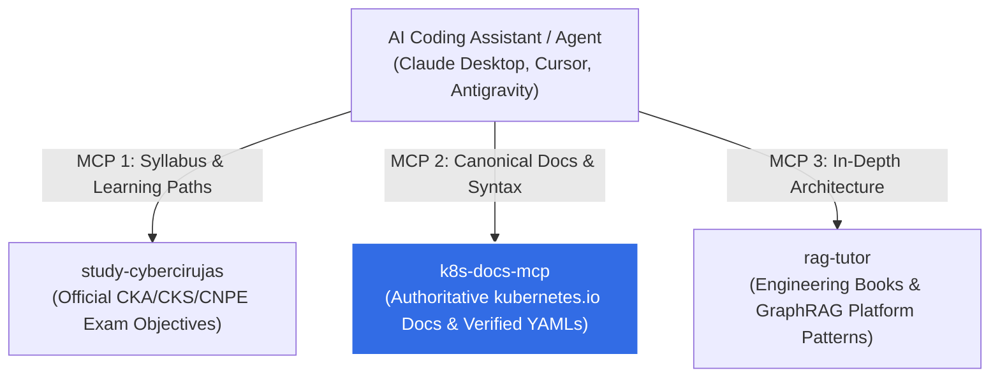

# k8s-docs-mcp ☸️

[](LICENSE)
[](https://python.org)
[](https://modelcontextprotocol.io)
[](https://kubernetes.io)

**Official Kubernetes Documentation & Canonical YAML Manifest Assistant for Autonomous AI Agents via the Model Context Protocol (MCP).**

`k8s-docs-mcp` connects your AI coding assistant (Cursor, Claude Desktop, Antigravity, VS Code) directly to the upstream source of truth: [`github.com/kubernetes/website`](https://github.com/kubernetes/website).

---

## 💡 The Problem: LLM "Version Blindness" & Hallucinations

General-purpose Large Language Models regularly fail when generating Kubernetes configurations because their training sets mix documentation across outdated releases:
- ❌ **Deprecated APIs:** Emitting `apiVersion: extensions/v1beta1` for `Ingress` instead of `networking.k8s.io/v1`.
- ❌ **Removed Features:** Suggesting `PodSecurityPolicy` (removed in K8s 1.25) instead of modern `PodSecurityStandards` or in-tree CEL `ValidatingAdmissionPolicy`.
- ❌ **Formatting Corruption:** Mangling YAML indentation, missing mandatory spec fields, or hallucinating non-existent controller flags.

**`k8s-docs-mcp` solves this deterministically:**
1. **Canonical YAML Manifest Extraction:** Extracts exact, verified YAML manifests directly from upstream Kubernetes documentation and examples in **< 20 ms**, completely bypassing generative LLM mutation.
2. **Current Upstream Documentation:** Delivers authoritative explanations with exact links to `https://kubernetes.io/docs/...`.
3. **Continuous Upstream Synchronization:** Pulls weekly updates directly from `kubernetes/website` (`content/en/docs` and `content/en/examples`) using sparse git checkouts to stay aligned with current Kubernetes releases.

---

## 🏛️ The Cloud Native Agent Trifecta

`k8s-docs-mcp` works as an independent standalone tool or as the authoritative documentation engine paired with syllabus guides and architectural tutors:



---

## 🛠️ Available MCP Tools

| Tool Name | Parameters | Description |
| :--- | :--- | :--- |
| `search_k8s_docs` | `query: str`, `limit: int = 3` | Performs high-speed BM25 search over official Kubernetes documentation. Returns authoritative excerpts and official `https://kubernetes.io/docs/...` URLs. |
| `get_canonical_manifest` | `kind: str` | Retrieves verified, unaltered Kubernetes YAML manifests directly from official examples for any resource Kind (`NetworkPolicy`, `ValidatingAdmissionPolicy`, `Deployment`, `ValidatingWebhookConfiguration`, etc.). |
| `list_supported_resources` | *None* | Lists all Kubernetes API resource Kinds currently indexed with canonical YAML manifests. |
| `sync_upstream_docs` | *None* | Fetches or updates documentation and examples from `github.com/kubernetes/website` and rebuilds the local index. |

---

## 🚀 Quickstart & MCP Configuration

### 1. Claude Desktop

Add `k8s-docs-mcp` to your `claude_desktop_config.json`:

```json
{
  "mcpServers": {
    "k8s-docs": {
      "command": "uvx",
      "args": ["k8s-docs-mcp"]
    }
  }
}
```

Or for a local development clone:

```json
{
  "mcpServers": {
    "k8s-docs": {
      "command": "uv",
      "args": [
        "--directory",
        "/path/to/k8s-docs-mcp",
        "run",
        "k8s-docs-mcp"
      ]
    }
  }
}
```

### 2. Cursor IDE

In your project root, add to `.cursor/mcp.json`:

```json
{
  "mcpServers": {
    "k8s-docs": {
      "command": "uvx",
      "args": ["k8s-docs-mcp"]
    }
  }
}
```

### 3. Local Development & Testing

```bash
# Clone the repository
git clone https://github.com/villadalmine/k8s-docs-mcp.git
cd k8s-docs-mcp

# Install dependencies using uv
uv sync

# Run test suite
uv run pytest tests/

# Execute interactive tool verification
uv run python -c "
from k8s_docs_mcp.server import search_k8s_docs, get_canonical_manifest

print(search_k8s_docs('validating admission policy'))
print('---')
print(get_canonical_manifest('NetworkPolicy'))
"
```

---

## 🔄 Automated Upstream Synchronization

`k8s-docs-mcp` uses a lightweight sparse checkout mechanism:
```bash
# Pulls only Markdown documentation and YAML examples (~25 MB instead of a 2 GB full clone)
uv run python -c "from k8s_docs_mcp.server import sync_upstream_docs; print(sync_upstream_docs())"
```

The repository includes a scheduled GitHub Action ([`.github/workflows/sync-upstream.yml`](.github/workflows/sync-upstream.yml)) that runs weekly to verify and update indexed Kubernetes documentation against the latest `kubernetes/website` main branch.

---

## 📜 Intellectual Property & Fair Use

- All documentation and manifest examples retrieved from `kubernetes/website` are licensed by the Kubernetes Authors under **Apache License 2.0** and **Creative Commons Attribution 4.0 International (CC-BY-4.0)**.
- `k8s-docs-mcp` attributes all excerpts directly to their canonical origin on [kubernetes.io](https://kubernetes.io).
- This project software is open-source under the **Apache License 2.0**. See [LICENSE](LICENSE) for details.
